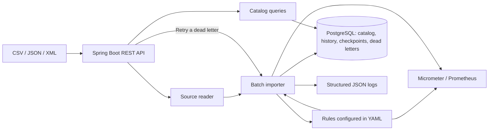

# Product Master Data Service

[](https://github.com/hamza2829/product-master-data-service/actions/workflows/ci.yml)

A Java backend that turns inconsistent product files into a searchable catalog. It applies configurable business rules, keeps a history of every change, and gives operators a reason and a retry path for each rejected row.

## Run in GitHub Actions

With an authenticated GitHub CLI and workflow access, use the run ID from the first or second command in the third. The job builds with Java 21 and Maven, tests with a PostgreSQL Testcontainer, then starts the packaged service and imports the fixtures into a separate PostgreSQL service container. For a fork, replace the repository in the commands.

```bash
gh workflow run ci.yml -R hamza2829/product-master-data-service --ref main
gh run list -R hamza2829/product-master-data-service -w ci.yml -b main --event workflow_dispatch --limit 5
gh run watch RUN_ID -R hamza2829/product-master-data-service --exit-status
```

Open the run summary for the measurements. The artifacts contain the JaCoCo HTML and XML reports, JUnit results, exact input files, and an import report with JSON logs and a Prometheus scrape. The workflow uses ephemeral runner storage and needs no personal tokens or configured secrets.

## Architecture



Spring Boot, JPA and Flyway handle the web layer, storage and schema. The importer hashes the file bytes with SHA-256 and commits rows in batches. Uploading the same bytes returns the prior report or resumes from the last committed checkpoint. Within one file the first accepted row for an article takes precedence. An equivalent row in a new file counts as unchanged, with history entries reserved for real changes.

The seeded [Java generator](src/test/java/io/github/hamza2829/catalog/demo/SyntheticData.java) produces the [baseline files](data/initial) and [update batches](data/updates). The fictional terminal blocks, connectors, power supplies, cables and relays use mixed column names, decimal separators, units, missing fields, duplicates and deliberately invalid values. The update files carry price, technical attribute and lifecycle changes. Blank fields in an update preserve their existing values.

## Rules and object-oriented design

Each rule implements the same `ProductRule` interface. The engine passes one row through normalization, enrichment, validation, deduplication and lifecycle checks. A rejection stops the pipeline for that row. Spring supplies the ordered rule objects and their configuration through constructor injection, so a unit test can construct any rule directly and use its own thresholds. Rules transform or check the row, and the batch writer handles the database transaction.

Edit [rules.yml](src/main/resources/rules.yml), or put a `rules-override.yml` in the service's working directory and restart. Thresholds, aliases, category mappings, duplicate handling and allowed lifecycle transitions are configurable. Normalized values use volts, amps, millimetres and euros. The default lifecycle moves from active to phase-out or discontinued, and from phase-out to discontinued.

## API and operations

| Method and path | Purpose |
| --- | --- |
| `POST /api/v1/imports` | Upload a multipart `file` and receive the import report. |
| `GET /api/v1/imports/{id}` | Read the committed checkpoint and outcome counts. |
| `GET /api/v1/products` | Page through products with optional `q`, `category` and `status` filters. |
| `GET /api/v1/products/{article}` | Read the current product and its newest-first history. |
| `GET /api/v1/rejections` | List dead letters and optionally filter by reason. |
| `POST /api/v1/rejections/{id}/retry` | Reapply the current rules to the stored row. |

The running service exposes Swagger UI at `/swagger-ui/index.html`, OpenAPI JSON at `/v3/api-docs`, health at `/actuator/health`, readiness at `/actuator/health/readiness` and metrics at `/actuator/prometheus`. Request failures return problem details with a stable `code`. The [runbook](docs/runbook.md) covers diagnosing rejections and interrupted imports. The [Grafana dashboard](docs/grafana/product-master-data.json) uses the same Prometheus metrics.

## Measured results

The [reference Actions run](https://github.com/hamza2829/product-master-data-service/actions/runs/44062701440) imported the seeded dataset into an empty PostgreSQL database. The HTTP wall time covers the uploads before the replay checks and excludes service startup.

| Measurement | Result |
| --- | ---: |
| Baseline files and update batches imported | 3 + 20 |
| File replays verified | 23 |
| Products stored | 500 |
| Records processed | 760 |
| Rows changed / unchanged / rejected | 740 / 1 / 19 |
| Full HTTP import wall time | 2,404 ms |
| Sum of service-reported import times | 2,028 ms |
| Tests passed | 27 / 27 |
| Unit and MockMvc tests passed | 19 / 19 |
| PostgreSQL Testcontainers tests passed | 8 / 8 |
| JaCoCo line coverage | 94.12% (656 / 697) |
| JaCoCo branch coverage | 77.66% (212 / 273) |

| Rejection reason | Records |
| --- | ---: |
| `DUPLICATE_ARTICLE` | 3 |
| `ILLEGAL_LIFECYCLE_TRANSITION` | 1 |
| `INVALID_ARTICLE` | 3 |
| `INVALID_NUMBER` | 3 |
| `INVALID_STATUS` | 3 |
| `MISSING_REQUIRED_FIELD` | 3 |
| `OUT_OF_RANGE` | 3 |

## Limits

This demo uses entirely synthetic data and invented business rules. It runs on loopback on a temporary Actions runner, with the service stopped at job exit. Uploads are synchronous and bounded in size. PostgreSQL serializes writes one batch at a time. Readiness includes the database, and OpenTelemetry trace and span IDs are recorded in the service logs.

OpenAI Codex wrote most of the code and reviewed it against the project requirements and CI results. Maintainer review and understanding remain unverified.

[MIT License](LICENSE)
